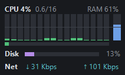
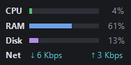

# Performance Widget

A small always-on-top window for Windows that shows one bar per CPU core, a RAM bar, and
optional disk and network rows. It is a single PowerShell script with a C# form compiled
at startup: no admin rights, nothing to build. It is built to stay light: hidden sections
are not sampled, and nothing repaints between samples.

<p>
  
  &nbsp;&nbsp;
  
</p>

Per-core view (left) and compact view (right), with every section turned on.

- **CPU**: one bar per logical core, green under 50%, amber under 85%, red above. The
  header gives the average and how many cores' worth are busy (`0.6/16`); the thin bar
  underneath is the whole machine. Values are `% Processor Utility`, the number Task
  Manager shows.
- **RAM**: physical memory in use, the tall bar on the right. Red from 85%.
- **Disk** (off by default): share of time the physical disks were busy.
- **Network** (off by default): received and sent, summed over all adapters.

Hover any bar or row for its live value and what it means.

## Install

Requires Windows 10 or 11 with Windows PowerShell 5.1 (built in). Paste this into a
PowerShell window:

```powershell
irm https://raw.githubusercontent.com/Krool/PerformanceWidget/main/install.ps1 | iex
```

That copies the widget to `%LOCALAPPDATA%\PerformanceWidget\app`, adds **Performance
Widget** to the Start Menu, and starts it in the bottom-right corner of your screen.

Prefer to read the script first? Download the zip from the
[latest release](https://github.com/Krool/PerformanceWidget/releases/latest), extract it,
and run:

```powershell
powershell -ExecutionPolicy Bypass -File .\install.ps1            # Start Menu shortcut, then start
powershell -ExecutionPolicy Bypass -File .\install.ps1 -Startup   # also start when you sign in
powershell -ExecutionPolicy Bypass -File .\install.ps1 -NoLaunch  # install without starting
```

To try it without installing anything, run the script directly:

```powershell
powershell -ExecutionPolicy Bypass -WindowStyle Hidden -File .\PerformanceWidget.ps1
```

Running the installer again updates the installed copy and restarts the widget. Your
settings are kept. Only one widget runs per user; a second launch exits quietly.

## Using it

- **Drag** with the left button to move it.
- **Double-click** to switch between per-core bars and the compact view.
- **Hover** for details. The text appears after half a second and follows you along the bars.
- **Right-click** for the options below. Every change is saved at once.

| Menu item | What it does | Default |
|---|---|---|
| Show all | Shows every section. Greyed out when nothing is hidden. | |
| CPU, RAM, Disk, Network | Show or hide that section. Hidden sections are not sampled. | CPU and RAM on |
| Per-core bars | Ticked: a bar per core. Unticked: the compact view. | On |
| Update interval | How often it samples: 0.5, 1, 2 or 5 seconds. | 1 s |
| Smoothing | Off (raw readings, no animation), Smooth, or Calm (slower to react). | Smooth |
| Opacity | 100, 90, 75, 60 or 40%. | 90% |
| Always on top | Keeps the widget above other windows. | On |
| Lock position | Stops dragging, so a stray click cannot move it. | Off |
| Start with Windows | Adds or removes a shortcut in your Startup folder. | Off |
| Reset position | Moves it back to the bottom-right corner of the main screen. | |
| Reload plugins | Loads plugins again after you add or edit one. Shown when plugins exist. | |
| About Performance Widget | Version, settings path and a link to this page. | |
| Exit | Closes the widget. Start it again from the Start Menu. | |

When the widget sits in the lower half of a screen it grows upward as sections are added,
so its bottom edge stays put; in the right half it keeps its right edge. A saved position
that is no longer on any screen (a monitor was unplugged) falls back to the default corner.

### When a reading fails

Failures are drawn, never shown as a plausible number:

- A core whose counter fails is hatched red and left out of the average; the header says
  `N failed` in red. It tries again next sample.
- A failed RAM or disk read hatches that bar and shows `--`. The network row shows `--`.
- No processor counters at all (a damaged counter registry) reads `CPU unavailable`.
  Running `lodctr /R` from an admin prompt usually repairs it.
- If the widget cannot start, it shows a message box and writes the error to
  `%LOCALAPPDATA%\PerformanceWidget\error.log`.

## Settings

Saved to `%LOCALAPPDATA%\PerformanceWidget\settings.json` on every change. You can edit it
by hand while the widget is closed; a bad value falls back to its default, and a corrupt
file is ignored.

| Key | Values |
|---|---|
| `X`, `Y` | Window position in screen pixels; `null` for the default corner |
| `Hidden` | Sections to hide: any of `"cpu"`, `"ram"`, `"disk"`, `"net"` |
| `Compact` | `true` for the compact view |
| `Interval` | Milliseconds between samples, 500 to 5000 |
| `Smoothing` | `"Off"`, `"Smooth"` or `"Calm"` |
| `Opacity` | 0.2 to 1.0 |
| `TopMost` | `true` to stay on top |
| `Locked` | `true` to stop dragging |
| `Plugins` | Paths to plugin scripts kept outside the plugins folder; `%VARS%` are expanded |

Delete the file to reset everything.

## Plugins

A plugin adds rows of its own under the built-in ones: a job queue, a build farm, a game
server. It is a `.ps1` file in `%LOCALAPPDATA%\PerformanceWidget\plugins`, or one listed in
the `Plugins` setting, that defines a function `Get-WidgetRows`. The widget calls it every
five seconds and draws one row per hashtable it returns:

```powershell
# %LOCALAPPDATA%\PerformanceWidget\plugins\builds.ps1
function Get-WidgetRows {
    $running = @(Get-Process msbuild -ErrorAction SilentlyContinue)
    @{ Key = 'builds'; Label = 'Builds'; Text = "$($running.Count) msbuild running"; Tip = 'MSBuild processes' }
}
```

| Field | Meaning |
|---|---|
| `Key` | Required. Unique id; hides like a section and is saved in `Hidden` |
| `Label` | Name in the right-click menu (defaults to `Key`) |
| `Text` | Text after the icon |
| `Note` | Short dim text at the right edge |
| `Icon` | Path to an `.exe`, `.ico` or image; a plain square without one |
| `Pips` | Array of slot states drawn as dots instead of `Text`: 0 free, 1 busy, 2 exclusive |
| `PipTips` | Hover text per pip |
| `Warn` | Red lines under the row |
| `Tip`, `WarnTip` | Hover text for the row and its red lines |
| `Mark`, `MarkTip` | 0 to 1: a blue tick on the whole-machine bar, with hover text |

Return nothing to hide a row while it has nothing to show. Each plugin runs in its own
module, so script-scope variables keep their values between calls. A plugin that fails to
load or throws keeps its last rows and adds a red error row naming it; hover for the
message. Plugins run with your permissions, like any script you run, so only add ones you
trust.

## Uninstall

```powershell
powershell -ExecutionPolicy Bypass -File "$env:LOCALAPPDATA\PerformanceWidget\app\uninstall.ps1"
```

This closes the widget, removes the Start Menu and Startup shortcuts, and deletes
`%LOCALAPPDATA%\PerformanceWidget`. Add `-KeepSettings` to keep your position and options.

## How it works

`PerformanceWidget.ps1` opens long-lived Windows performance counters (Processor
Information, PhysicalDisk, Network Interface) and reads RAM with `GlobalMemoryStatusEx`.
Sampling, smoothing, a short ease-in after each sample and painting all happen in a small
C# WinForms class compiled by `Add-Type`, so PowerShell sits idle while the widget runs and
nothing repaints between samples.

## Tests

```powershell
powershell -ExecutionPolicy Bypass -File .\test.ps1
```

Each case runs the real script in `-Snapshot` mode (draws the window off screen, saves a
PNG, prints its state and hover text, exits) with a private settings folder, so it never
touches your settings or a running widget. It covers defaults, every section, injected
read failures, the compact view, plugins and malformed settings. About a minute.

The screenshots above come from the same mode:

```powershell
powershell -ExecutionPolicy Bypass -File .\PerformanceWidget.ps1 -Snapshot docs\screenshot.png -ShowAll
```

## License

[MIT](LICENSE) © Krool
